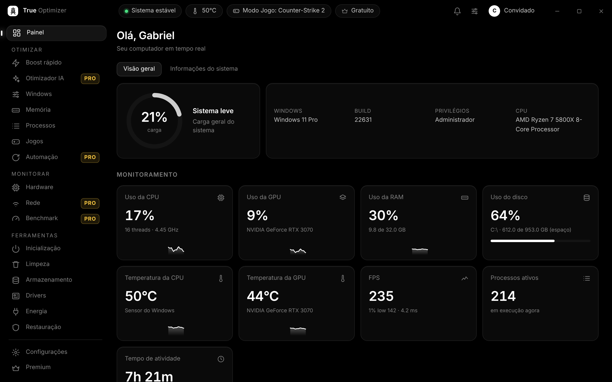
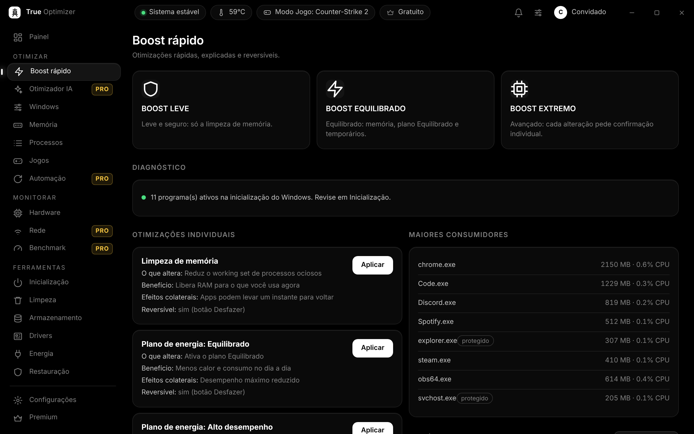
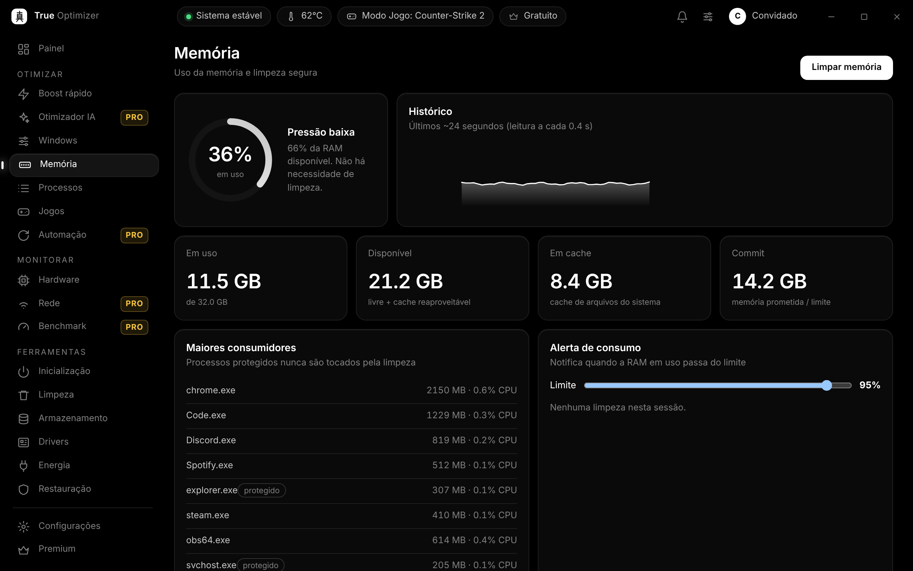
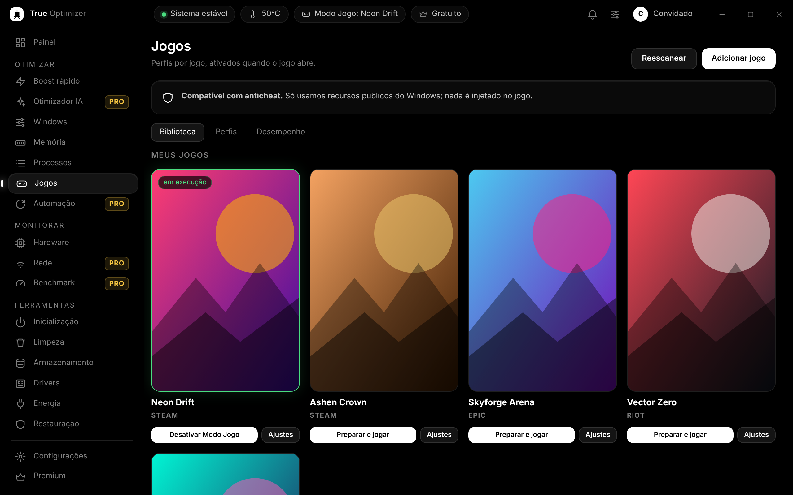
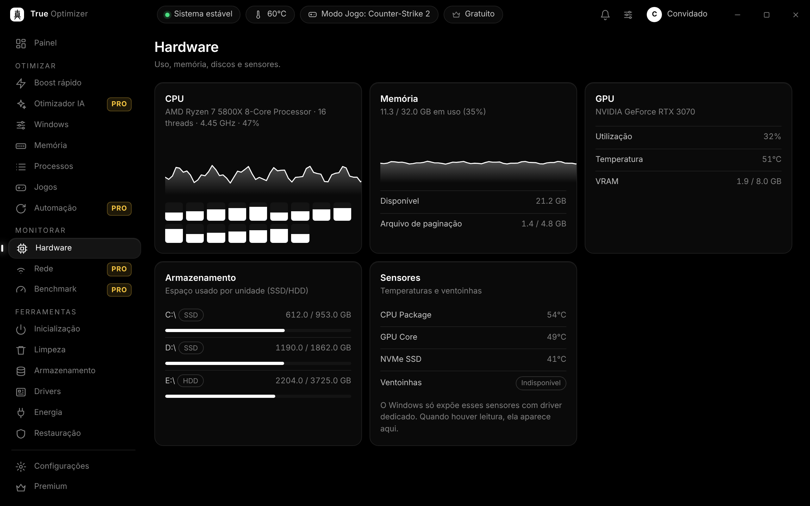

  <b>True Optimizer</b> 
  <b>Mais desempenho no Windows, com tudo registrado e reversível.</b>

  
  
  

  
  
  
  

  

---

## Por que o True Optimizer?

- **Tudo é registrado e pode ser desfeito.** Cada ajuste fica no histórico e você volta atrás quando quiser.
- **Sem sujeira.** Fechar o app desfaz o que estava ativo (Modo Jogo, automações).
- **Tudo em um lugar.** Do Boost rápido aos drivers, sem precisar de vários programas.
- **Seguro.** Atualizações assinadas digitalmente: o app só instala o que foi publicado por nós.

## Recursos

### Grátis

| | |
|---|---|
| **Painel** | Visão geral do seu PC em tempo real |
| **Boost rápido** | Um clique para liberar desempenho |
| **Ajustes do Windows** | Configurações que influenciam o desempenho |
| **RAM** | Acompanhe e libere memória |
| **Processos** | Veja o que está rodando e o que pesa |
| **Jogos** | Modo Jogo e histórico com **FPS médio** e **1% low** da sessão inteira |
| **Hardware** | Informações do seu equipamento |
| **Inicialização** | Controle o que abre junto com o Windows |
| **Limpeza** | Remova arquivos desnecessários |
| **Rede** | Ferramentas e ajustes de conexão |
| **Benchmark** | Meça o desempenho do PC |
| **Armazenamento** | Veja e gerencie o uso dos discos |
| **Drivers** | Acompanhe seus drivers |
| **Energia** | Planos e ajustes de energia |
| **Restauração** | Desfaça alterações feitas pelo app |
| **Atualização automática** | Detecta e instala versões novas, com assinatura verificada |

### Premium (com conta True)

| | |
|---|---|
| **Otimizador IA** | Sugestões de otimização feitas para o seu PC |
| **Automação** | Regras que aplicam ajustes sozinhas |
| **Rede e RAM avançadas** | Controles extras para quem quer ir além |
| **Temas** | Personalize a aparência do app |
| **Sincronização** | Suas configurações acompanham a sua conta |

  
  

  
  

Imagens ilustrativas, com dados e jogos de exemplo.

## Como instalar

1. Abra a página de [**Releases**](../../releases/latest) e baixe o arquivo `True.Optimizer_..._x64-setup.exe`.
2. Execute o instalador.
3. Pronto. Abra o True Optimizer e comece pelo **Painel** ou pelo **Boost rápido**.

> **O Windows mostrou "O Windows protegeu o computador"?**
> Clique em **Mais informações** e depois em **Executar assim mesmo**. As **atualizações** do app
> são sempre verificadas por assinatura digital.

## Perguntas frequentes

**É de graça?**
Sim, os recursos principais são gratuitos. O Premium libera os extras com a sua conta True.

**Posso desfazer o que o app fez?**
Sim. Tudo é registrado, e a aba **Restauração** permite voltar atrás. Além disso, fechar o app desfaz o que estava ativo, como o Modo Jogo e as automações.

**Funciona no Mac ou no Linux?**
Por enquanto, só no Windows 10 e 11.

**Como o app se atualiza?**
Sozinho: ele detecta versões novas, confere a assinatura digital e instala.

**Encontrei um problema ou tenho uma ideia.**
Abra uma [issue aqui](../../issues).

## Criadores

<table>
  <tr>
    <td align="center">
       
      <a href="https://github.com/yanghyperx"><b>Yang</b></a> 
      Engenharia
    </td>
    <td align="center">
       
      <a href="https://github.com/zHobbit02"><b>Victor</b></a> 
      Produto &amp; Design
    </td>
  </tr>
</table>

Feito pela equipe da [True Ltda](https://github.com/True-Ltda).

## Suporte

- Problemas e sugestões: [Issues](../../issues)
- Novidades de cada versão: [Releases](../../releases)

O código-fonte do True Optimizer não é público. Este repositório distribui os instaladores e as notas de cada versão.

---

<b>English</b>

### True Optimizer: performance tuning for Windows, fully logged and reversible

Dashboard, quick Boost, Windows tweaks, RAM, processes, games, hardware, startup, cleanup, network, benchmark,
storage, drivers, power and restore, all in one app. Every change is logged and can be undone, and closing the app
reverts whatever was active (Game Mode, automations).

**Install:** download `True.Optimizer_..._x64-setup.exe` from the [latest release](../../releases/latest) and run it.
If Windows SmartScreen warns you, click **More info → Run anyway**. Every in-app update is verified with a digital signature.

**Premium (True account):** AI Optimizer, automation, advanced network and RAM controls, themes and sync.

**Support:** [open an issue](../../issues). The source code is private; this repository only distributes the installers and release notes.

Feito com carinho · True

